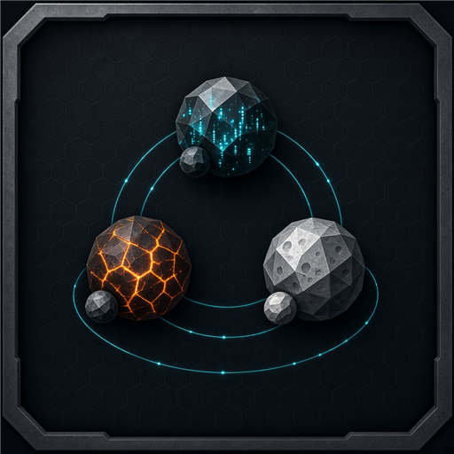

# Hardness



Client mod for **Planetary Annihilation: Titans**. In Galactic War, only your home system stays small. The first enemy system is already 2 planets, then the count climbs to 3, 4, 5, and 6 as you move outward. You land on one planet. Every other planet is held by 3 enemy commanders, or 4 on the 5-planet and 6-planet systems.

A new war also starts you with 3 random technologies. After each battle the cache shows 5 cards. You take 2, and Reroll deals another 5. The tech bank is forced back to 40 slots after every card rebuild, so a win cannot shrink it to 4. Build speed, costs, health, and AI personality are unchanged.

## What changes

- Only home stays a one-planet system. The first battle, one hop from home, is 2 planets. Then 3, 4, 5, and 6.
- You land on one of those planets, chosen at random each battle.
- Each other planet gets 3 enemy commanders. Systems with 5 or 6 planets get 4 on each other planet.
- Those commanders use `off_player_planet`, so they do not spawn on your planet.
- Home is the only system left on the original small layout.
- A new war deals 3 random technologies into your inventory. The bank stays at 40 slots, including after a win rebuilds it.
- Each technology cache shows 5 cards. Take two. Reroll replaces them with 5 new cards. Click the first choice again to change it. Commander unlocks still take one card.

## Requirements and limits

- Needs **Titans** and **Galactic War Overhaul** (`com.pa.quitch.gwaioverhaul`). The ramp reads GWO's hop count; the stock galaxy builder sends a different number, so the ramp would not line up without it.
- GWO settings change the ramp. Large Planets adds 4 to the system size, so home and nearby stars get bigger systems. System Scaling off picks random sizes, so many stars become 6 planets. Co-op adds one size per extra player. Single-player with default settings gives the table above.
- The start cards, the top-up to 5 cards, and rerolls are dealt from the stock deck, not from GWO's own deck.
- Rerolls are unlimited and free.
- Single-player only. Co-op is not supported.
- When a system has more enemy slots than the target, extra enemy slots are removed, including bosses and minions. Armies left with no slots are dropped.

## Install

1. Download or clone this repository.
2. Copy the `com.pa.local.gw_hardness` folder into your Titans client mods folder. The folder name must stay `com.pa.local.gw_hardness`.

   Windows:

   ```
   %LOCALAPPDATA%\Uber Entertainment\Planetary Annihilation\client_mods\com.pa.local.gw_hardness
   ```

3. Start Titans. Enable **Hardness** in the mods list if it is not already on.
4. Start a **new** Galactic War. Systems in a war you already saved were generated without this mod and will not change.
5. Fight a system far from home. The browser console should log `Hardness templates:` when the war is created, and `Hardness spawn:` when a multi-body battle starts.

## Notes

- This is a local client mod for single-player Galactic War. It does not change skirmish.
- It is meant to run next to Galactic War Overhaul. Overhaul picks system size from distance from home; Hardness only replaces the later template groups.
- Built against game build `116982`.
